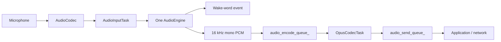

# Audio Service Architecture

`AudioService` owns one input engine and keeps codec I/O, Opus encoding/decoding,
and network queues independent from the chip-specific speech pipeline.

## Input engines

The old `AudioProcessor + WakeWord` combinations have been replaced by a single
`AudioEngine` interface. `AudioInputTask` reads PCM once and feeds exactly one
engine.

| Target | Engine | Wake word | Uplink processing |
| --- | --- | --- | --- |
| ESP32-S3 / ESP32-P4 / ESP32-S31 | `AfeAudioEngine` | WakeNet inside AFE, or MultiNet fed from AFE output | FD AEC + VAD when audio processing is enabled |
| ESP32 / ESP32-C3 / ESP32-C5 / ESP32-C6 | `LiteAudioEngine` | Standalone WakeNet when configured | Raw mono PCM |

`AfeAudioEngine` owns a single FD AFE instance. WakeNet and voice uplink share
that instance, so enabling both no longer creates two AFE pipelines. For custom
MultiNet wake words, AFE fetch output is passed to `CustomWakeWord`; MultiNet is
not created on the smaller targets.

`AudioService::GetWakeWords()` returns the phrases supported by the initialized
engine, independently of the last detected phrase. WakeNet lists only active
models; MultiNet lists the display text of commands with the `wake` action.
After successful startup, the first idle state enables wake-word detection and
shows these phrases in an assistant chat message after idle UI cleanup. The
message is removed after five seconds on OLED and LCD displays. The timeout only
removes the matching hint, preserving newer messages and alerts. Disabled or failed
wake-word detection and startup errors suppress the hint; subsequent idle transitions
do not repeat it.

The AFE configuration currently uses `FD_LOW_COST` AEC with
`AEC_NLP_LEVEL_VERYAGGR`. WebRTC/NSNet noise suppression is intentionally
disabled because the project does not ship an NSNet model.

When wake-word audio upload is enabled, the most recent two seconds of PCM are
stored in a single 64 KB PSRAM ring buffer. WakeNet and MultiNet share the same
cache implementation, and the encoder reads it one Opus frame at a time. This
avoids the previous per-chunk internal-SRAM allocations and temporary PCM
concatenation buffer.

## Input data flow

### Board input layouts

Built-in boards default to one microphone: `M` without a playback reference, or
`MR` when the codec supplies a playback reference. `R` must contain playback
reference samples, not a second microphone. The channel declaration must match
the interleaved PCM returned by the codec.

Multiple-microphone input remains available for developer experiments; the AFE
still derives its format from the codec's microphone and reference counts.
For Box Lite, the final `BoxAudioCodecLite` constructor parameter is
`microphone_channels`, defaulting to `1`. Pass `2` explicitly to test `MMR`
with reference enabled, or `MM` without it. `EnableInput()` and `Read()` use this
count for capture and interleaving. On ESP32-S31-Korvo-1, developers can change
the board's `AUDIO_INPUT_CHANNELS` from `1` to `2` to test `MM`; its codec has no
playback reference. Neither experimental layout is enabled in default builds.

Single-microphone defaults do not imply that ESP-SR FD lacks dual-microphone
support, or guarantee hardware operation. Validate capture, playback, wake/VAD,
interruption, reconnect, and applicable AEC modes on the affected board before
releasing a change. Box Lite's software playback reference also needs timing
and concurrency validation.

Wake-word detection and voice processing are independent runtime states on the
same engine. On AFE targets, AEC stays active while wake-word detection is active
so playback reference remains available for wake-up during device playback. It
also stays active during voice processing when device AEC is requested.

## Output data flow

## Tasks and power management

- `AudioInputTask` reads codec input and feeds the selected engine.
- `AudioOutputTask` drains decoded PCM to the codec output.
- `OpusCodecTask` encodes uplink PCM and decodes downlink packets.
- `AfeAudioEngine` has its own AFE fetch task on S3/P4/S31.

The audio power timer still enables and disables codec ADC/DAC channels based on
activity; the engine refactor does not change that policy.

## Queue and allocation policy

The service queues use compile-time fixed-capacity storage. Their existing drop,
wait, and playback-drain policies remain unchanged, but queue growth no longer
allocates deque nodes. `AudioTask` values are stored directly, and Opus encoding
writes into the packet payload instead of allocating a second temporary output
buffer. Packet and PCM buffer pools should only be added after target-side heap
and latency measurements justify their additional ownership complexity.

## Resampling diagnostics and failure handling

`AudioResampler` owns a rate-conversion handle and reusable, guarded scratch storage.
The input instance is serialized by `input_resampler_mutex_`; the output instance is
owned exclusively by `OpusCodecTask`. Callers must serialize configuration, processing,
reset and destruction. The wrapper accepts interleaved signed 16-bit PCM, 1–8 channels,
positive rates up to 192 kHz, and at most one second per call (service packets are at
most 120 ms). Output capacity is checked before allocation. A failed call leaves PCM
unchanged and the caller discards that frame; vendor errors close the handle so the
next configuration can retry. Zero output frames are not sent to the audio engine.

Logs record converter identity, rates, channels, input/output frame counts, buffer
addresses, error codes, free internal/PSRAM memory and stack high-water mark. Normal
traces cover the first three calls after configuration, then at most every five seconds.
They contain no audio payload or credentials. Output-buffer guards are checked on
every call. A damaged guard aborts deliberately to retain a diagnostic core instead
of continuing with damaged memory. Full-heap integrity walks are deliberately excluded
from audio tasks: a hardware trial stalled in the heap walker and reset via watchdog.
The bounded guards cannot detect arbitrary corruption elsewhere in the heap. Logs also
include sampled call duration; they are evidence, not proof of long-term stability.

Decoder configuration validates rate/duration metadata and shares the reset mutex
through close/open. Decoded size and format are checked before resampling. ES8311
read/write holds the same mutex as enable/close, preventing deletion of an in-use
device; I/O errors return zero samples instead of reporting success. The underlying
I2S I/O timeout remains one second, so a failing operation can delay another codec
operation by that amount.

This application patch does not change the retained Vibe Mode or SDK reset path.
`AudioService::Stop()` still requests asynchronous shutdown; complete DMA quiescence
across every warm-restart entry point requires separate lifecycle work and validation.
