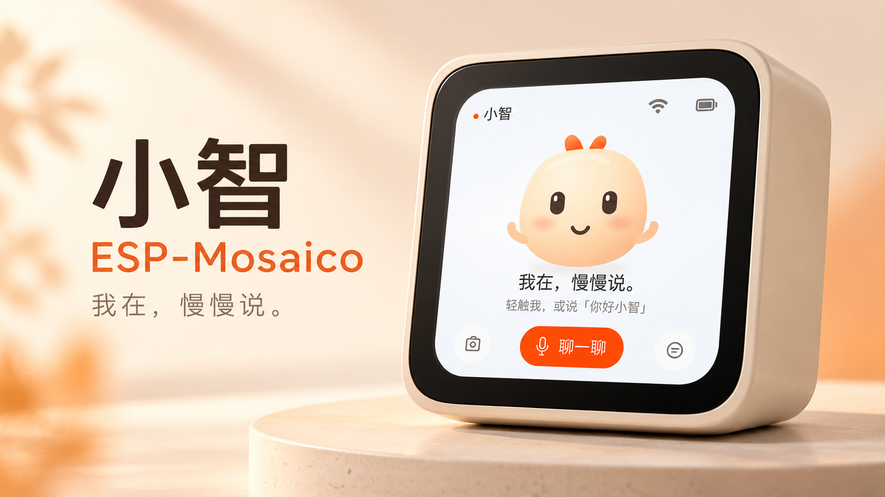
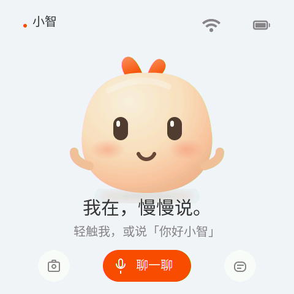
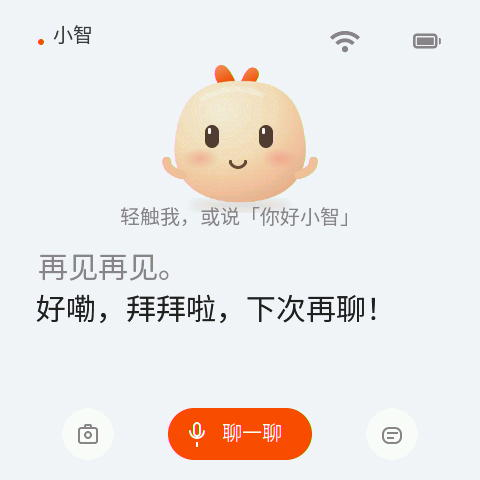
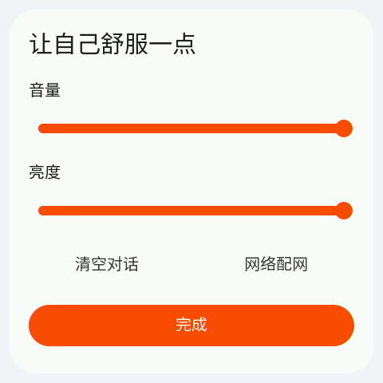

# 小智 · ESP-Mosaico 语音伙伴

基于 [XiaoZhi](https://github.com/78/xiaozhi-esp32) 的 ESP-Mosaico 语音助手，支持中文对话、触屏伙伴、会话记录，以及可选摄像头取景和拍照问答。

## 图片预览 / Gallery

主图为 AI 生成的产品效果图，用于展示应用形象；下面三张为设备直接截取的真实界面。
The cover is an AI-generated product visualization. The following images are actual device screenshots.

### 主页面 / Home

“我在，慢慢说。”轻触伙伴或点击“聊一聊”开始交流。

### 语音对话 / Conversation

对话时伙伴缩小，屏幕展示识别内容和小智回复。

### 下拉设置 / Settings

调节音量、亮度，清空对话，或进入“网络配网”。

本次上传为 **2.5.3 开发调试版**，适用于 ESP32-S31、16 MiB Flash 的 ESP-Mosaico 产品分区布局，要求 Vibe Mode 0.2.0 或更新版本。请通过 Mosaico 的兼容性检查安装，保留 Vibe Mode。固件包含应用和字体/表情资源，不含设备身份、Wi-Fi 凭据或 Vibe Mode 镜像。

## 使用

- 连接 Wi-Fi 并按小智服务的提示完成激活；云端语音和图像问答需要可用网络及服务端配置。
- 点击伙伴或对话按钮开始交流。历史按钮查看本次启动以来的记录，重启后清空。
- 下滑顶部菜单调整音量和亮度、清空记录，或点击“网络配网”进入热点配网。
- 小智尚未保存 Wi-Fi 时，会读取 Vibe Mode 共享的 SSID 和密码作为初始配置；已有配置优先。
- 摄像头模块需在开机前连接。摄像头按钮打开取景，拍照按钮请求图像描述。首次图像问答前应先连通一次语音服务。对话期间暂停实时取景，空闲后恢复。

## 验证与限制

实体屏幕的下滑残留横纹已由用户确认消失；当前音频调试固件的语音回复正常，验证期间未重启。重复打开和关闭摄像头的六轮检查未观察到重启，但此前报告的偶发摄像头异常尚未确认根因。测试已暂停，尚无长时间稳定性结论。热重启后的摄像头/DMA 状态仍需继续排查。

源码及构建说明见 [ESP-Mosaico 分支仓库](https://github.com/lisir233/esp-mosaico-xiaozhi)。本次包使用已验证的二进制离线打包，没有重新编译或重新烧录。

## English

XiaoZhi voice companion for ESP-Mosaico (ESP32-S31, 16 MiB Flash), with a touch companion UI, session history, Wi-Fi provisioning and optional camera preview/photo questions. Network connectivity and XiaoZhi service activation are required. Camera modules must be connected before boot; live preview pauses during conversation.

This is a **2.5.3 development/debug build**, requiring Vibe Mode 0.2.0 or later and the compatible Mosaico product partition layout. Voice replies and the display stripe fix were checked on hardware. Intermittent camera behavior and long-running stability remain under investigation. This upload reuses the tested binary; it does not perform another hardware test.

## 许可 / License

应用源码沿用上游 MIT 许可，第三方依赖保留各自许可。设备介绍页字形由 Noto Sans CJK 派生，使用 SIL Open Font License 1.1，见随包附带的 [字体许可](FONT-LICENSE.txt)。伙伴图形为本项目原创，不是 Mosaico 官方吉祥物。
